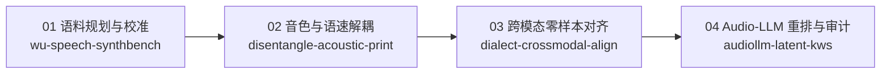

<h1>Hi, I'm leeoisaboy 👋</h1>

  <strong>AI 产品经理 · AI Product Builder（多模态与语音方向）</strong> 
  AI Product Manager & Builder (Multimodal & Speech) · White-Box Evaluation · Post-Training · AI Agent Workflows

  
  
  
  

  
  
  

  
  
  

---

### 💡 核心优势 · What Sets My Work Apart

- **🔬 源自真实场景的可视化算法原型（CBB 预研沉淀）**：低资源方言语音「白盒四部曲」并非纸面论文复现，而是我在 **AI 产品经理（语音方向）实习**中，围绕**技术预研与公共基础模块（CBB）搭建**的算法试错里沉淀出的工程产物——全部封装为**零后端、可实验、可视化的浏览器白盒工作台**（支持 60 FPS 实时麦克风、拖入 WAV、手拖超参现场验算），让每个算子与指标肉眼可见。
- **📊 评测先行与诚实消融**：拒绝黑盒玄学调参——公开五折交叉验证淘汰的阴性实验、80ms/40ms 双网格防泄漏审计、跨域路由陷阱（AUROC `0.999` → 命中率 `4%`）以及 CosyVoice 四关断路排障全记录。
- **🚀 从模型微调到产品闭环**：既能深入 PyTorch / LoRA / DoRA / DPO / Flow Matching / DiT 底层架构调优，也能交付 Codex Skill、多模态图文/视频自动化管线等真实落地的 AI 产品工具。

---

## 🧭 全景作品看板 · Featured Portfolio (8 Flagship Projects)

> GitHub 首页置顶栏仅支持 6 个仓库，以下看板完整呈现我的 **8 个核心公开项目**，涵盖 **白盒方言语音四部曲**、**CosyVoice 语音合成微调**、**古籍多模态 OCR** 与 **AI Agent 工作流**。

### 🎙️ 方向一：白盒低资源方言语音四部曲（White-Box Dialect Speech Quartet）

| 阶段 | 项目仓库 | 在线交互台 | 核心亮点与技术指标 |
| :--- | :--- | :---: | :--- |
| **01 合成与评测** | **[wu-speech-synthbench](https://github.com/leeoisaboy/wu-speech-synthbench)**  | [▶ SynthBench Studio](https://leeoisaboy.github.io/wu-speech-synthbench/) | 零资源方言合成语料规划、能量谷信号级自动切字、Robust MAD 概率校准与防刷分评测；**全仓纯 NumPy**，零后端实时试算。 |
| **02 声学解耦** | **[disentangle-acoustic-print](https://github.com/leeoisaboy/disentangle-acoustic-print)**  | [▶ Acoustic Print Studio](https://leeoisaboy.github.io/disentangle-acoustic-print/) | 免训练跨音色声学指纹：正交投影剥离说话人音色 + 等弧长重采样消除语速变化；内置 **60 FPS 浏览器实时麦克风**四轨示波器。 |
| **03 跨模态对齐** | **[dialect-crossmodal-align](https://github.com/leeoisaboy/dialect-crossmodal-align)**  | [▶ CrossModal Align Lab](https://leeoisaboy.github.io/dialect-crossmodal-align/) | 开放词表零样本 OOV 组合式检索、语速不变跨模态注意力、FSQ 离散晶格与**路由陷阱模拟器**（直击 AUROC `0.999` 跨域崩塌至 `4%`）。 |
| **04 重排与审计** | **[audiollm-latent-kws](https://github.com/leeoisaboy/audiollm-latent-kws)**  | [▶ Audit Studio](https://leeoisaboy.github.io/audiollm-latent-kws/) | 冻结 Audio-LLM 免训练方言检索：80ms/40ms 双网格防泄漏审计、Top-20 语境重排、**Prefix KV-Cache `2.14×` 加速**与五折阴性实验公开。 |

---

### 🎵 方向二：语音合成微调与跨代架构评测（CosyVoice TTS & Chanting）

| 项目仓库 | 关注度 | 演示 / 资料 | 核心亮点与技术指标 |
| :--- | :---: | :---: | :--- |
| **[cosyvoice-lora-finetune-framework](https://github.com/leeoisaboy/cosyvoice-lora-finetune-framework)** |  | [▶ Bilibili 调试纪实](https://www.bilibili.com/video/BV1Sti7B9ENN/) | 从 Loss 卡死 `28+` 到成功突破：通过**四关断路测试**定位「语义泄漏」根因，设计 **LLM + Flow 联合 LoRA 训练**，实现**无 Prompt 推理**与极少样本音色定制。 |
| **[lora-cosyvoice123-chanting](https://github.com/leeoisaboy/lora-cosyvoice123-chanting)** |  | [🎧 试听与架构海报](https://github.com/leeoisaboy/lora-cosyvoice123-chanting#试听演示) | 面向中文古诗词吟诵的 **CosyVoice 1 / 2 / 3 三代跨架构 LoRA 实验框架**：同一数据集横向对比 LLM / FSQ / Flow / DiT 骨干差异与 prompt 边界，提出吟诵专用客观评估公式。 |

---

### 📜 方向三：多模态古籍 OCR 与 AI Agent 工作流（Multimodal VLM & Agent Skills）

| 项目仓库 | 关注度 | 场景定位 | 核心亮点与技术指标 |
| :--- | :---: | :---: | :--- |
| **[paleomindocr-evahan2026](https://github.com/leeoisaboy/paleomindocr-evahan2026)** |  | 古籍多模态 OCR | **EvaHan 2026 闭模态赛道完整解决方案**：YOLO 古籍版面检测 + `Xunzi-Qwen2-VL-7B` **DoRA 微调** + **DPO 强化学习**专项攻克生僻字与复杂版面识别。 |
| **[WeMD-SKILLS](https://github.com/leeoisaboy/WeMD-SKILLS)** |  | AI Agent Skill | 面向微信公众号 / WeMD 的**多模态配图与 15s 片头视频自动化 Codex Skill**：`Qwen Image 3.0` 主用、`Seedream 5.0` 备用、`wan3.0-video` 电影感片头 + 自动图床上传，真实落地于公众号「一个AI产品经理的周记」。 |

---

## ✍️ 最新周记 · Weekly Notes

> 公众号 **「一个AI产品经理的周记」** 同步更新，由 [WeMD-SKILLS](https://github.com/leeoisaboy/WeMD-SKILLS) 在发文后自动归档全部周记（首屏展示最新 5 期，往期自动折叠收纳）。

<!-- WEEKLY_NOTES_START -->
- `2026-11-21` | [AI产品经理实习周记｜先在局部打穿闭环，再顺着利益链条推开全局](https://mp.weixin.qq.com/s/aTnQgaOekvqOIn9bHt2y-A) — 先在单点场景跑通真实闭环，再沿业务与协作利益链条逐步推开全局。
- `2026-11-14` | [AI产品经理实习周记｜怎么思考下一代解决方案和产品形态](https://mp.weixin.qq.com/s/wH5EdQVfIrtgUE7hZz00JA) — 先画完整服务链，再把存量资产放回去，用真实断点倒推下一代硬件形态。
- `2026-11-10` | [AI产品经理实习周记 | 硬件开发是层层递归而环环相扣的导演艺术——以《盗梦空间》为例](https://mp.weixin.qq.com/s/SO-x652iHHrA0Ma3c7Q00g) — 把半年硬件开发拆成五幕，用三次全员同步的决策制定点控制多层协作。
- `2026-11-06` | [AI产品经理实习周记｜一枚语音徽章背后的供应商尽调](https://mp.weixin.qq.com/s/xomx82ugsJNUr1fV9lTP8A) — 在签约付款前核验供应商资质、能力和交付风险，判断对方能否持续交付。
- `2026-11-05` | [AI产品经理实习周记｜一台智能音箱的硬件开发流程](https://mp.weixin.qq.com/s/gSKo73XbClmJJdAE68nRoQ) — 从一台智能音箱的制造流程看硬件开发的关键环节、角色分工与协作边界。
<!-- WEEKLY_NOTES_END -->

---

## 🛠️ 技术栈 · Tech Stack

| 领域 | 核心工具与技术 |
| :--- | :--- |
| **Speech & Audio AI** | `CosyVoice 1/2/3` · `Flow Matching` · `DiT` · `FSQ` · `Audio-LLM` · `Keyword Spotting` · `Signal Processing (FFT / CUSUM / Pure NumPy)` |
| **Multimodal & Fine-Tuning** | `PyTorch` · `Qwen2-VL` · `LoRA / DoRA` · `DPO / RLHF` · `YOLO` · `Zero-Shot Cross-Modal Alignment` |
| **Evaluation & White-Box Viz** | `Leakage-Aware CV` · `Probability Calibration` · `Ablation & Negative Experiments` · `Zero-Backend Interactive Web Studios (GitHub Pages)` |
| **AI Product & Agent** | `Codex Skills` · `Qwen Image 3.0 / Seedream 5.0 / Wan 3.0` · `FastAPI` · `Gradio` · `Python` · `Go` |

---

  ✍️ 微信搜索公众号 <strong>「一个AI产品经理的周记」</strong> 查看更多 AI 产品思考与多模态工程实践

